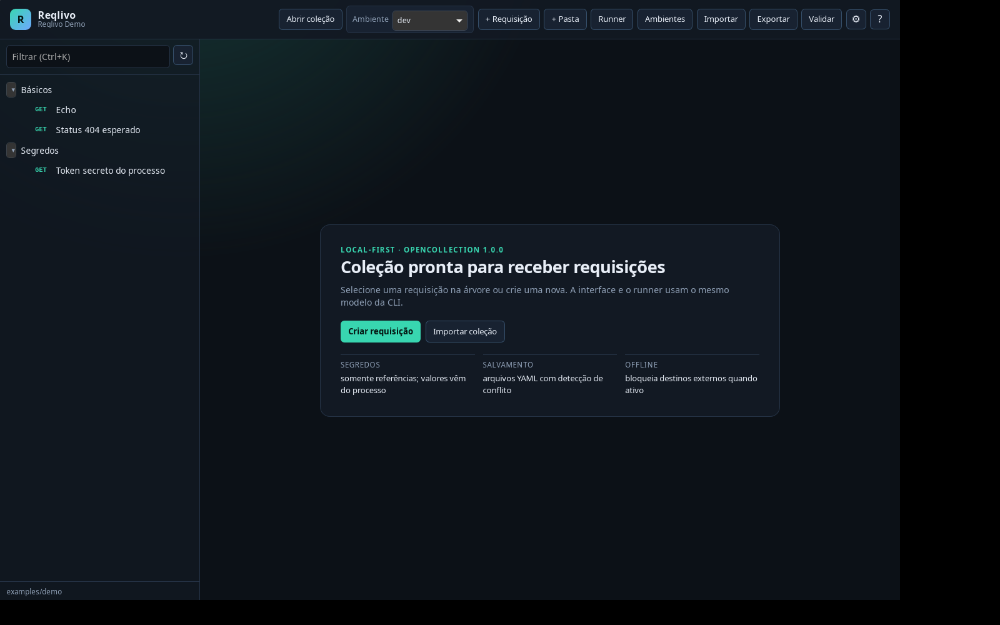

# Desktop Linux e Windows

**Implementado:** aplicativo híbrido Tauri 2, mantendo HTML/CSS/JavaScript na WebView e o núcleo Rust compartilhado com a CLI. A interface anterior pelo navegador e o comando `serve` foram removidos. Os alvos iniciais são Linux x86_64 e Windows x86_64.

## Instalação

Baixe os artefatos da versão atual em [GitHub Releases](https://github.com/Andre-Ricardo/reqlivo/releases). A [0.3.0](https://github.com/Andre-Ricardo/reqlivo/releases/tag/v0.3.0) está publicada com:

| Sistema | Artefato | Dependência de execução |
|---|---|---|
| Linux Debian/Ubuntu | `.deb` | WebKitGTK 4.1; instalado pelo gerenciador de pacotes |
| Linux | `.AppImage` | Sistema compatível com Ubuntu 22.04 ou posterior; pode exigir FUSE |
| Windows 10/11 | instalador NSIS `.exe` | WebView2, instalado pelo instalador quando necessário |

O arquivo `SHA256SUMS` acompanha a release. Não há assinatura de código nem atualização automática nesta etapa.

## Desenvolvimento

Requisitos: Rust estável recente, Node.js 22 com npm e as [dependências oficiais do Tauri](https://v2.tauri.app/start/prerequisites/). A CLI do núcleo pode ser compilada sem dependências gráficas.

Ubuntu/Debian, com privilégios administrativos:

```bash
sudo apt-get update
sudo apt-get install -y build-essential curl wget file libssl-dev libwebkit2gtk-4.1-dev libappindicator3-dev librsvg2-dev patchelf xdg-utils
```

No Windows, instale Visual Studio Build Tools com a carga de trabalho C++ para desktop e o SDK Windows, Rust com toolchain MSVC, Node.js 22 e WebView2. Execute os comandos abaixo no diretório do repositório:

```bash
npm ci
npm run desktop:dev
```

Para abrir uma coleção existente:

```bash
npm run desktop:dev -- -- --collection examples/demo
```

Sem argumento, o aplicativo reabre a última pasta escolhida em **Abrir coleção**. Se ela não estiver disponível, usa uma coleção inicial em `app_data_dir()/colecao`. O caminho selecionado fica em `app_data_dir()/last-collection.txt`. Uma pasta inválida escolhida pelo diálogo mantém a coleção anterior aberta. Se a coleção exigir migração, o app não migra sozinho: mostra o diálogo de inspeção e mantém a coleção anterior ativa até confirmar ou cancelar.

Use **Abrir coleção** para trocar a pasta. O guardião de navegação pede confirmação antes de descartar um rascunho ou fechar uma janela com alterações; **Manter rascunho** preserva a edição em `.reqlivo/drafts/`. Para criar uma coleção em outra pasta, use `reqlivo --collection minha-api init --name "Minha API"` e selecione a pasta no aplicativo. Exportações de conteúdo usam diálogo nativo de salvamento.

## Arquitetura e permissões

- `src-tauri/`: janela, diálogos nativos, seleção da coleção e empacotamento.
- `src/assets/`: interface empacotada por `frontendDist`, sem servidor de desenvolvimento frontend.
- `src/desktop.rs`: ponte testável que executa operações `/api/*` em memória por `Router::oneshot`.
- `src/server.rs`: contratos de CRUD, execução, cancelamento, importação e exportação preservados; nenhum listener ou asset HTTP.
- O comando Tauri `api_request` aceita somente caminhos internos e GET/POST/PUT/DELETE. Não é um proxy HTTP. APIs de destino continuam no transporte Rust.
- A capability é restrita à janela local `main`, sem origens remotas nem plugins de shell/filesystem. Diálogos são chamados pelo Rust. A CSP permite IPC e assets locais.
- A troca de coleção reinicia cookies e cancela operações do estado anterior. A UI exige concluir/cancelar execuções antes da troca.

## Build e verificações

```bash
cargo fmt --all -- --check
cargo test --locked
cargo test --workspace --locked
python3 scripts/check-version.py
```

`cargo test --locked` testa somente o núcleo e a ponte IPC, sem GTK/WebKit. O comando com `--workspace` também compila o desktop e exige as dependências gráficas.

```bash
# Linux
npm run desktop:build -- --bundles deb,appimage -- --locked
# Windows
npm run desktop:build -- --bundles nsis -- --locked
```

Instaladores ficam em `target/release/bundle/`. O AppImage preserva caminhos relativos de `--collection` usando o diretório original `OWD` ou o `PWD` preservado pelo shell, mesmo quando o launcher altera o diretório de trabalho. O build não exige um servidor Node.js e o aplicativo instalado não depende de Node.js.

## Releases no GitHub

[Workflow desktop](../.github/workflows/desktop.yml):

1. PRs e pushes para `main` executam testes do workspace e geram instaladores Linux/Windows como artifacts da execução. O disparo manual faz o mesmo, sem publicar release.
2. Uma tag `v*` verifica que as versões em `Cargo.toml`, `src-tauri/Cargo.toml`, `src-tauri/tauri.conf.json`, `package.json` e `package-lock.json` coincidem com a tag.
3. Somente após os dois builds passarem, o job com `contents: write` publica uma release com os três instaladores e checksums SHA-256. Uma reexecução substitui os assets da mesma tag.
4. Usa o `GITHUB_TOKEN` automático; não exige token pessoal ou certificado em secrets.

Para publicar a versão preparada, depois de integrar e validar o código:

```bash
git tag v0.3.0
git push origin v0.3.0
```

Para uma versão posterior, atualize os cinco manifestos (`Cargo.toml`, `src-tauri/Cargo.toml`, `src-tauri/tauri.conf.json`, `package.json` e `package-lock.json`) e as entradas dos pacotes próprios em `Cargo.lock`; gere o lock npm com `npm install --package-lock-only` quando necessário. Confira a consistência antes de criar a tag. A versão 0.3.0 foi publicada em 2026-10-27 na tag `v0.3.0`: o workflow remoto passou em Linux e Windows, publicou os três instaladores e o `SHA256SUMS`, e a [release](https://github.com/Andre-Ricardo/reqlivo/releases/tag/v0.3.0) foi verificada. A instalação manual em máquinas limpas e a matriz manual de desktop continuam pendentes.

## Validação e lacunas

Os testes da ponte IPC verificam criação/persistência/reabertura/exclusão, erros estruturados e rejeição de caminhos externos. Os testes HTTP existentes continuam verificando o transporte e o cancelamento. O CI compila e empacota o desktop em Linux e Windows, inicia o AppImage no Linux e aguarda até trinta segundos por uma janela visível; no Windows, verifica o executável após dez segundos. No Linux, usa D-Bus e Openbox em uma sessão X11 isolada no Xvfb, exige janela visível e rejeita captura uniforme e registra a imagem como artifact `desktop-smoke-linux`.

**Observado em execução na 0.2.0:** 64 testes locais aprovados; `cargo check -p reqlivo-desktop --locked` e build debug aprovados. Os builds Linux e Windows geraram os três instaladores e abriram os executáveis. O `.deb` produzido pelo GitHub foi extraído e executado localmente.

**Observado em execução nesta feature:** 107 testes locais aprovados em Linux; `cargo fmt --check`, `cargo test --locked`, `cargo test --workspace --locked`, `cargo check --manifest-path src-tauri/Cargo.toml`, `node --check` e o verificador de versão passaram. A demonstração CLI passou com o servidor sintético, e o cenário de migração/rollback foi executado em cópia temporária. Um harness de teste em Chrome headless exercitou 11 fluxos de interface (rascunhos, guardião, autosave, alterações externas, comparação, YAML inválido, ID duplicado, manifesto e teclado/foco); ele usa um exemplo separado e não cria listener no produto. Evidências: [checks](../../evidencias/reqlivo-v0.3.0/checks.txt), [UI headless](../../evidencias/reqlivo-v0.3.0/ui/ui-acceptance.txt), [capturas](../../evidencias/reqlivo-v0.3.0/ui/), [demonstração](../../evidencias/reqlivo-v0.3.0/demo-cli.txt) e [migração](../../evidencias/reqlivo-v0.3.0/migracao-cli.txt). Os testes automatizados novos cobrem rascunhos, gerações, conflitos, lixeira, migração e a rota IPC de recuperação. O workflow remoto passou em `ubuntu-22.04` e `windows-latest` na [pré-validação](https://github.com/Andre-Ricardo/reqlivo/actions/runs/40542757635) e na [publicação da tag v0.3.0](https://github.com/Andre-Ricardo/reqlivo/actions/runs/40544605429); a release contém `.deb`, `.AppImage`, `.exe` e `SHA256SUMS`.



Validação interativa ainda necessária em cada plataforma: primeiro uso, seleção/cancelamento de pasta, editar/salvar/enviar, autosave e recuperação de rascunho, alteração externa com comparação, lixeira, confirmação/rollback de migração, cancelar execução, importar/exportar e fechar janela com rascunho. Build automatizado não equivale a teste visual ou execução de instalador. A execução local do desktop depende da instalação de GTK/WebKit no ambiente de desenvolvimento.

## Referências consultadas

Documentação local: [uso](uso.md), [MVP](mvp.md), [Tauri](tauri.md), [bibliotecas Rust](bibliotecas-rust.md). Consulta Context7: `/websites/tauri_app`, tópicos de comandos/estado/IPC e distribuição GitHub.

Documentação oficial: [comandos Rust](https://v2.tauri.app/develop/calling-rust/), [configuração](https://v2.tauri.app/reference/config/), [capabilities](https://v2.tauri.app/security/capabilities/), [diálogos](https://v2.tauri.app/plugin/dialog/), [GitHub Actions](https://v2.tauri.app/distribute/pipelines/github/).
